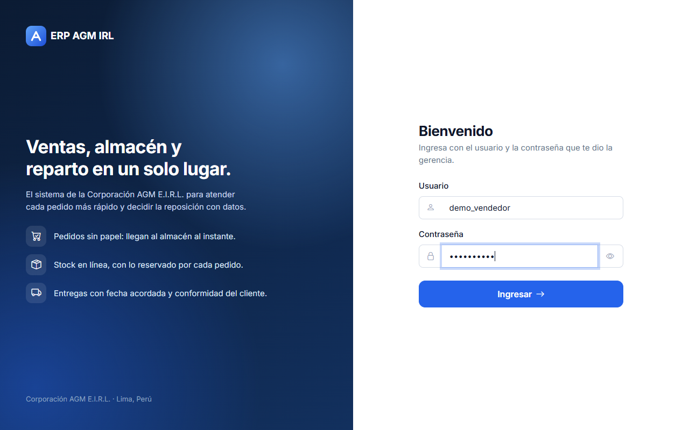
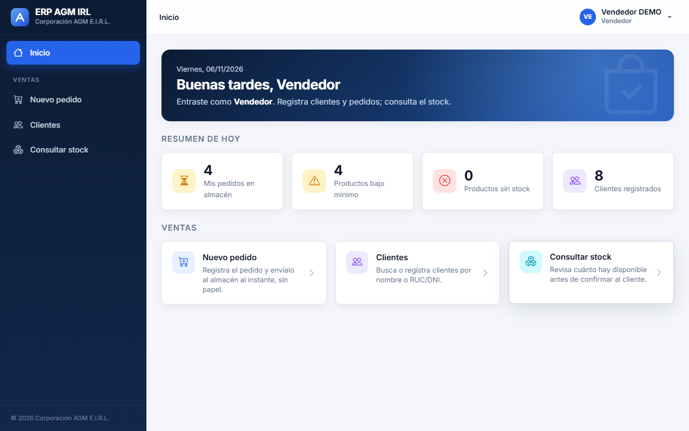
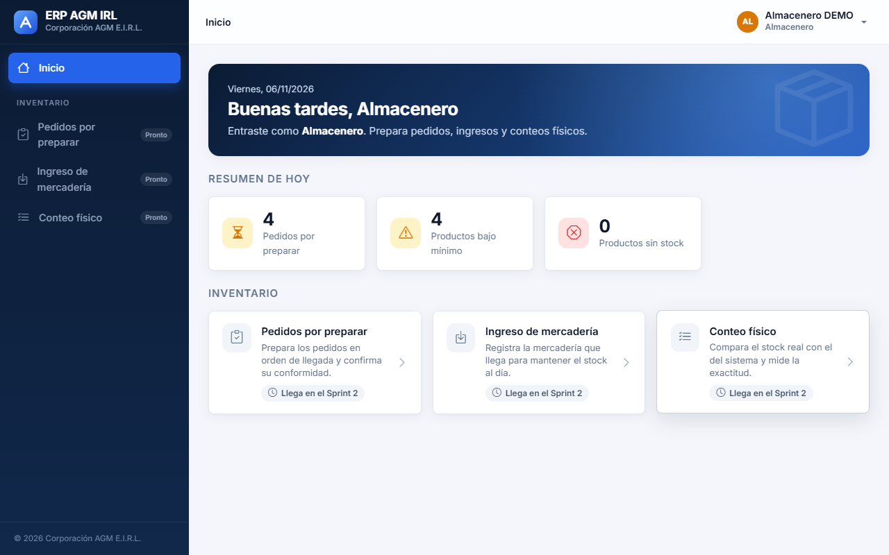
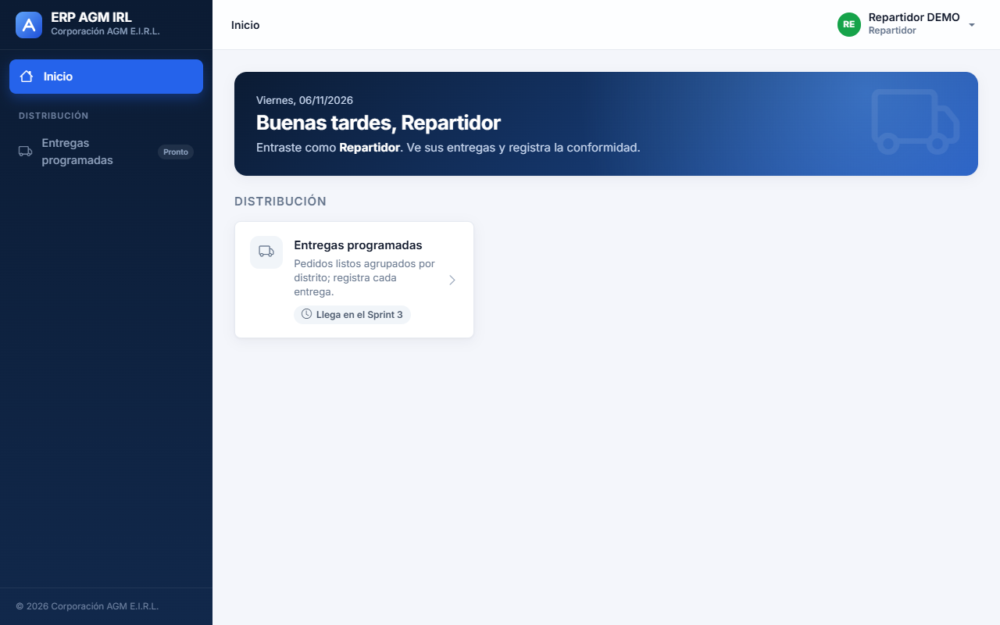
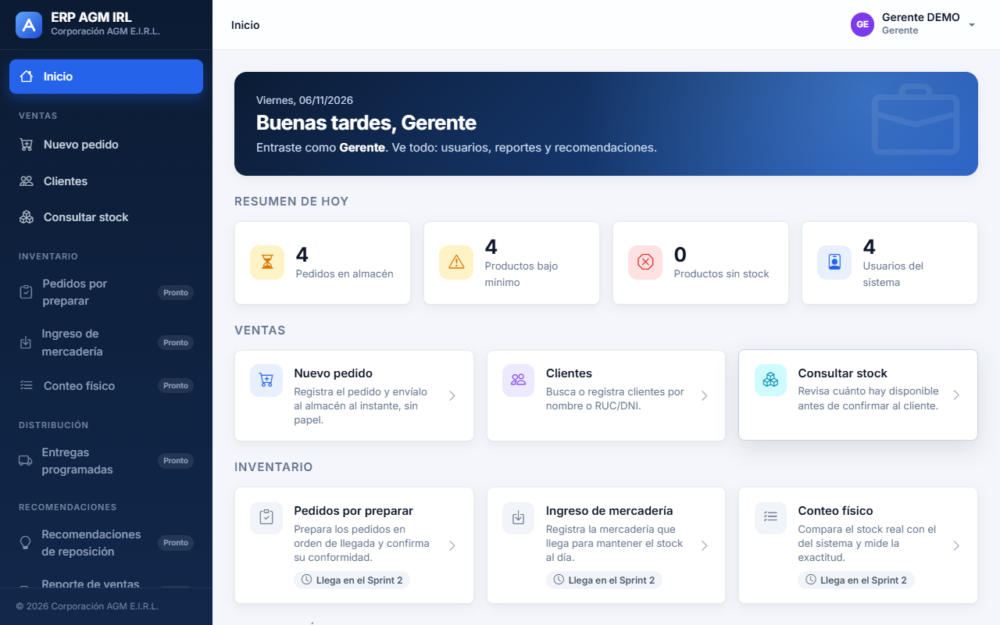
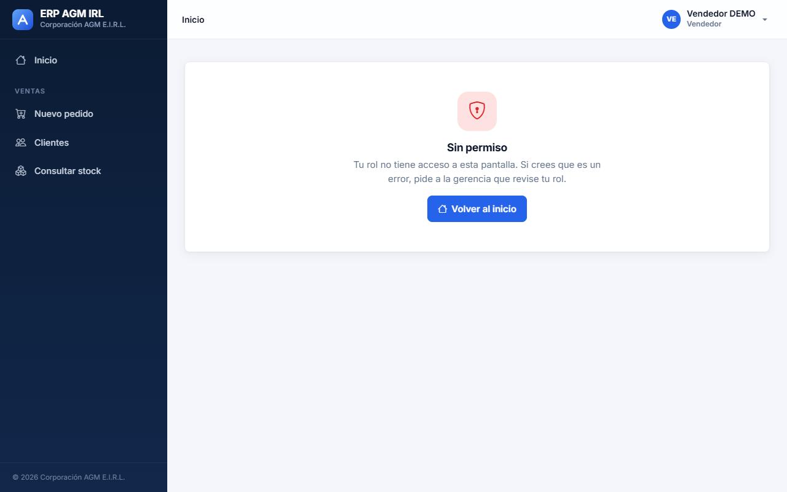

# Sprint Review — Sprint 0: Preparación

| Dato | Valor |
|---|---|
| Sprint | 0 — Preparación (Tabla II de la tesis: «Diseño del sistema», dimensión *Modularidad e integración*) |
| Fecha de la review | 05/11/2026 |
| Fecha planificada (Tabla II) | 04/11 al 06/11 |
| Commit del incremento | `e4da288` — «Sprint 0: preparación del ERP AGM IRL» (05/11/2026) |
| Pruebas automáticas del backend | **40 de 40 correctas** (`python manage.py test`) |
| Compilación del frontend | `npm run build` sin errores |
| Pruebas en navegador (Chrome) | 25 de 25 comprobaciones correctas (menú por rol, rutas protegidas, celular) |
| Resultado | **Aprobado** por el Product Owner el 05/11/2026 |
| Revalidación tras el rediseño | 06/11/2026, commit `6cd93ff`: 26 de 26 comprobaciones en Chrome (ver la review del Sprint 1, sección «Rediseño de la interfaz») |
| Nombre legal de la empresa | 06/11/2026: la interfaz muestra «Corporación AGM E.I.R.L.» (inicio de sesión, menú lateral y pie). El nombre del sistema, «ERP AGM IRL», no cambia. Capturas rehechas; 31 de 31 comprobaciones del Sprint 0 en Chrome (5 nuevas sobre el nombre) |

## Objetivo del sprint

Dejar listo el entorno y la base común del sistema para construir los módulos en los sprints 1 a 4: repositorio,
base de datos única, modelo de datos completo, autenticación por roles y la aplicación React con su navegación.

## Elementos del Product Backlog terminados

El Sprint 0 no tiene historias de usuario: prepara la base sobre la que se construyen las HU01 a HU15.

| Elemento | Criterio de terminado | Cómo se verificó | Estado |
|---|---|---|---|
| Repositorio y entorno | Git desde el primer commit; `requirements.txt`, `package.json`, `.env.example` y README en español | Commit `e4da288`; `.env` excluido del repositorio | ✅ |
| Docker con PostgreSQL | PostgreSQL 16 se levanta con `docker compose up -d db` | Base `erp_agm_irl` en uso por el sistema y las pruebas | ✅ |
| Modelos y migraciones | Las 13 entidades de la Fig. 10 con los métodos de la Fig. 11 | `makemigrations --check` sin cambios; 25 pruebas de modelos | ✅ |
| Roles y autenticación JWT | Cada usuario entra con su contraseña y recibe su rol; el rol se valida en el backend | 8 pruebas en `usuarios/tests/test_auth.py` | ✅ |
| Admin de Django | Todos los modelos registrados, en español | `/admin/` responde «Iniciar sesión \| ERP AGM IRL» | ✅ |
| Comando `seed_demo` | 20 productos de la muestra, usuarios por rol e historial con estacionalidad, todo marcado DEMO; existe `borrar_demo` | 7 pruebas en `usuarios/tests/test_demo.py` | ✅ |
| React: inicio de sesión, menú por rol y barra superior | Cada rol ve solo su menú; el gerente ve todo; vista adaptada a celular | Capturas de abajo y prueba en navegador | ✅ |

### Métodos del diagrama de clases (Fig. 11) implementados y probados

| Clase | Métodos | Pruebas |
|---|---|---|
| Pedido | `calcular_total()`, `confirmar_conformidad()`, `tiempo_atencion()` | `ventas/tests/test_modelos.py` (7) |
| Entrega | `programar()`, `registrar_entrega()`, `esta_a_tiempo()` | `distribucion/tests/test_modelos.py` (5) |
| ConteoFisico | `calcular_exactitud()` | `inventario/tests/test_modelos.py` (2 de 9) |
| Pronostico | `acierto()` | `recomendaciones/tests/test_modelos.py` (2 de 4) |
| Recomendacion | `aceptar()`, `rechazar()` | `recomendaciones/tests/test_modelos.py` (1 de 4) |
| Producto | `consultar_stock()`, `actualizar_stock()` | `inventario/tests/test_modelos.py` (7 de 9) |

## Detalle de las pruebas automáticas (40)

| Archivo | Pruebas |
|---|---|
| `usuarios/tests/test_auth.py` | 8 |
| `usuarios/tests/test_demo.py` | 7 |
| `inventario/tests/test_modelos.py` | 9 |
| `ventas/tests/test_modelos.py` | 7 |
| `distribucion/tests/test_modelos.py` | 5 |
| `recomendaciones/tests/test_modelos.py` | 4 |

## Evidencia (Chrome, 1280×800, datos DEMO)

Capturas actualizadas el 06/11/2026 con la interfaz rediseñada (commit `6cd93ff`). Muestran la funcionalidad de este
sprint (inicio de sesión, menú por rol y validación del rol) con la presentación vigente. Las pantallas marcadas
«Pronto» en el menú se construyen en los sprints siguientes.

**Inicio de sesión**

**Inicio y menú del vendedor**

**Inicio y menú del almacenero**

**Inicio y menú del repartidor**

**Inicio y menú del gerente (ve todos los módulos)**

**El vendedor intenta abrir una pantalla del almacén: «Sin permiso»**

## Decisiones tomadas en la review

| Tema | Decisión del Product Owner |
|---|---|
| Versión de Node.js | Se acepta Node.js 26 LTS (la que instala `winget`) en lugar de la 20. |
| Reserva de stock | Manda la tesis (7.3, Tabla IV y Fig. 7): al registrar el pedido se reserva el stock. Disponible = `stock_actual` − cantidades de los pedidos `en_almacen`, sin cambiar el modelo de datos. Se implementa en el Sprint 1. |
| Campo `es_demo` | Se acepta como campo técnico; no se incluye en la tesis. |
| Estados del pedido | `en_almacen`, `preparado` y `entregado`. |
| Fechas de entrega | `fecha_acordada` y `fecha_entrega` son fechas sin hora. |
| Historial real de ventas | En pausa: no se dispone aún del Excel. No se implementa nada del Sprint 4 hasta nuevo aviso. |
