# Sprint Review — Sprint 1: Módulo de ventas

| Dato | Valor |
|---|---|
| Sprint | 1 — Módulo de ventas (Tabla II de la tesis, dimensión *Atención del pedido*) |
| Fecha de la review | 05/11/2026 |
| Fecha planificada (Tabla II) | 09/11 al 13/11 |
| Commit del incremento | `cd5bc2a` — «Sprint 1: módulo de ventas (HU01 a HU04)» (05/11/2026) |
| Pruebas automáticas del backend | **73 de 73 correctas** (33 nuevas en este sprint + 40 del Sprint 0) |
| Compilación del frontend | `npm run build` sin errores |
| Pruebas en navegador (Chrome) | 19 de 19 comprobaciones correctas (flujo completo de HU01 a HU04 y vista de celular) |
| Resultado | El Product Owner indicó continuar con el Sprint 2 (06/11/2026) |
| Rediseño de la interfaz | 06/11/2026, commit `6cd93ff` — observación de usabilidad de esta review (ver la sección «Rediseño de la interfaz») |
| Nombre legal de la empresa | 06/11/2026: la interfaz muestra «Corporación AGM E.I.R.L.»; capturas rehechas con los mismos nombres. 75 de 75 pruebas del backend y 54 de 54 comprobaciones en Chrome |

## Objetivo del sprint

Que el vendedor registre el pedido en el sistema y lo envíe al almacén sin imprimirlo, viendo en ese momento el stock
disponible; y que el gerente administre los usuarios y sus roles.

## Historias de usuario terminadas

| ID | Historia de usuario (Tabla V) | Criterio de aceptación | Pruebas | Estado |
|---|---|---|---|---|
| HU01 | Como gerente, quiero crear usuarios con un rol (vendedor, almacenero, repartidor o gerente), para que cada persona use solo sus funciones. | Cada usuario ingresa con su contraseña y ve solo el menú de su rol. | 9 (`usuarios/tests/test_hu01_usuarios.py`) | ✅ Terminada |
| HU02 | Como vendedor, quiero registrar y buscar clientes, para no volver a escribir sus datos en cada pedido. | El cliente se encuentra por nombre o por RUC o DNI, y queda guardado con su distrito. | 7 (`ventas/tests/test_hu02_clientes.py`) | ✅ Terminada |
| HU03 | Como vendedor, quiero consultar el stock disponible de un producto, para confirmar al cliente si hay mercadería. | El stock que se muestra es el mismo que registra el módulo de inventario. | 6 (`inventario/tests/test_hu03_stock.py`) | ✅ Terminada |
| HU04 | Como vendedor, quiero registrar el pedido con sus productos y cantidades, para enviarlo al almacén sin imprimirlo. | El pedido queda con número, total y hora de registro, y aparece en la lista del almacén. *Acordado en la review del Sprint 0:* si la cantidad supera el disponible, se avisa («Solo quedan N») y no se registra esa línea. | 11 (`ventas/tests/test_hu04_pedidos.py`) | ✅ Terminada |

### Cómo se cumple cada criterio

- **HU01.** El gerente crea el usuario con su rol desde «Usuarios y roles»; la contraseña se valida y se guarda cifrada.
  Al iniciar sesión, el servidor devuelve el rol y el menú muestra solo sus pantallas. El rol se vuelve a validar en cada
  endpoint: los demás roles reciben «sin permiso» (403). Un usuario desactivado ya no puede entrar.
- **HU02.** Búsqueda por nombre (parcial, sin importar mayúsculas) o por RUC/DNI. El distrito es obligatorio. Se valida
  que sea un DNI de 8 dígitos o un RUC de 11, y que no se repita.
- **HU03.** La consulta sale directamente de inventario. Muestra el **disponible** = `stock_actual` − lo reservado por
  pedidos en almacén (reserva de la tesis, 7.3 y Tabla IV), además de lo reservado y lo que hay en almacén. Los productos
  con disponible menor que el stock mínimo se marcan «Bajo mínimo».
- **HU04.** El número (`P-000001`; `D-` en los datos DEMO), el total, el precio unitario y la hora de registro los pone
  el sistema: lo que envíe el usuario en esos campos se ignora. El pedido queda «En almacén», crea su Entrega con la fecha
  acordada y aparece en la lista del almacén en orden de llegada. Si una línea supera el disponible, la pantalla avisa
  «Solo quedan N» y no deja agregarla; el servidor vuelve a validar y bloquea los productos mientras registra, para que
  dos vendedores no reserven el mismo stock. `stock_actual` no baja al registrar: baja cuando el almacén confirma (HU06).

### Prueba de la reserva de stock

`test_la_reserva_de_un_pedido_en_almacen_impide_vender_ese_stock_otra_vez` (HU04): con 40 unidades, un pedido de 30
deja 10 disponibles; un segundo vendedor que pide 11 recibe «Solo quedan 10» y no se registra nada; con 10 sí se
registra. `stock_actual` sigue en 40 y no se crea ningún movimiento de inventario.

## Detalle de las pruebas automáticas (73)

| Archivo | Pruebas | Sprint |
|---|---|---|
| `usuarios/tests/test_hu01_usuarios.py` | 9 | 1 |
| `ventas/tests/test_hu02_clientes.py` | 7 | 1 |
| `inventario/tests/test_hu03_stock.py` | 6 | 1 |
| `ventas/tests/test_hu04_pedidos.py` | 11 | 1 |
| Pruebas del Sprint 0 (modelos, autenticación y datos DEMO) | 40 | 0 |
| **Total** | **73** | |

## Evidencia (Chrome, 1280×800, datos DEMO)

Capturas actualizadas el 06/11/2026 con la interfaz rediseñada (commit `6cd93ff`). Las historias y sus criterios de
aceptación son los del commit `cd5bc2a`.

**HU01 — Usuarios y roles (gerente)**

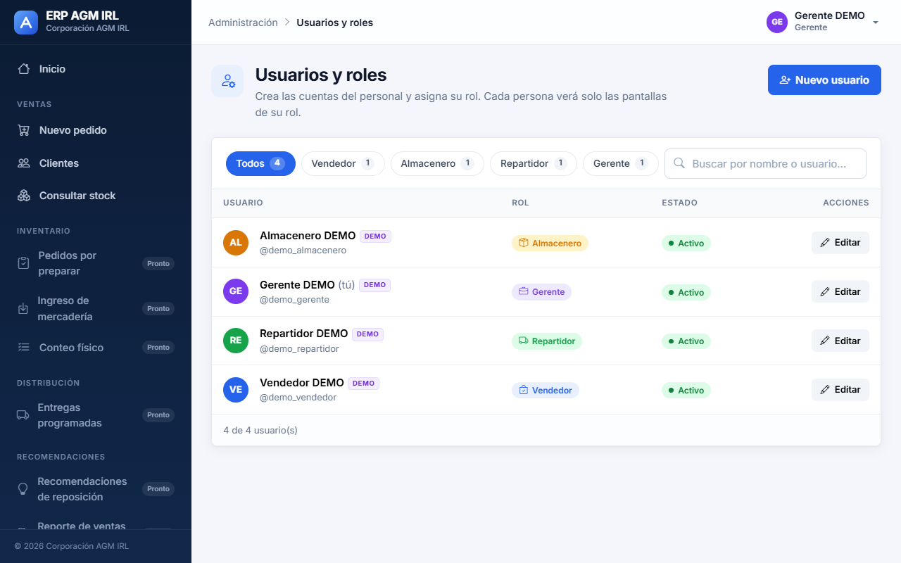

**HU01 — Crear un usuario con su rol**

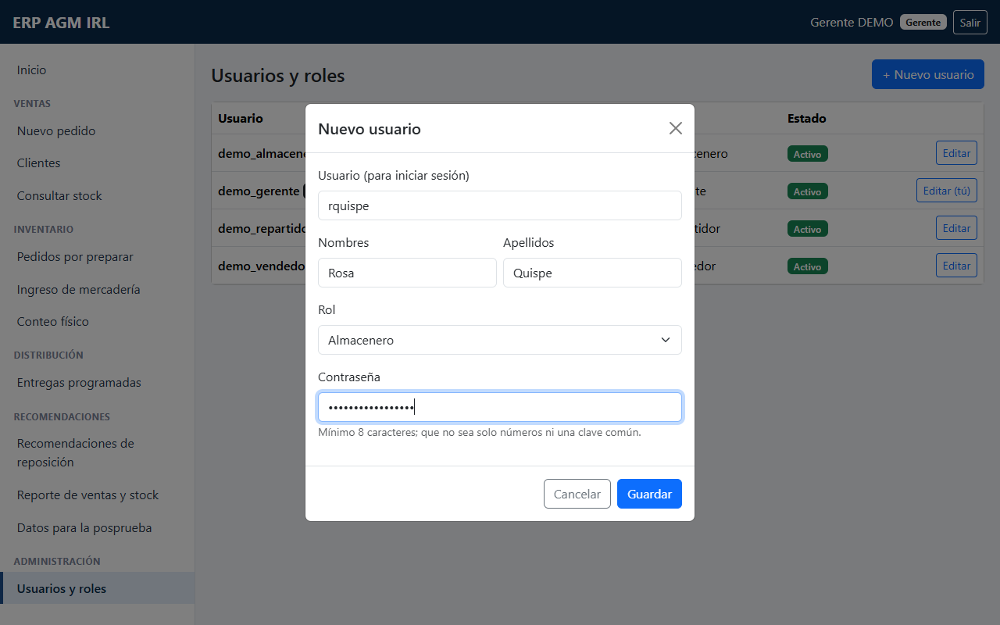

**HU02 — Clientes**

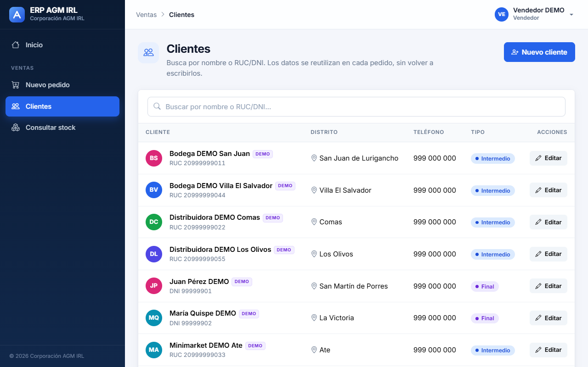

**HU02 — Búsqueda por RUC**

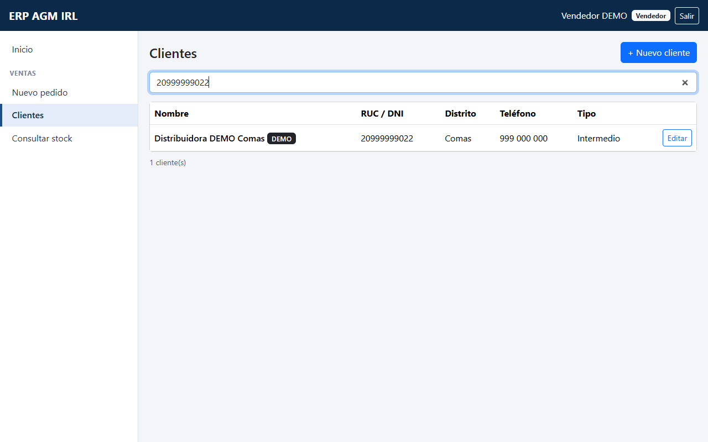

**HU02 — Registrar un cliente con su distrito**

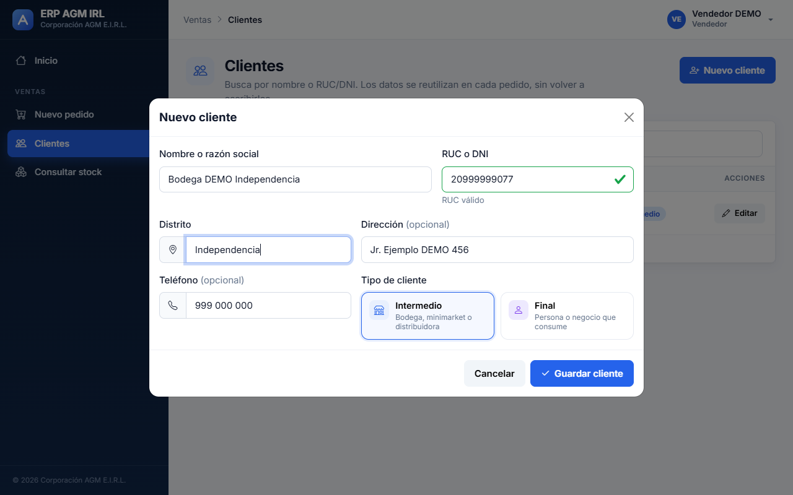

**HU03 — Consulta de stock disponible, con productos «Bajo mínimo»**

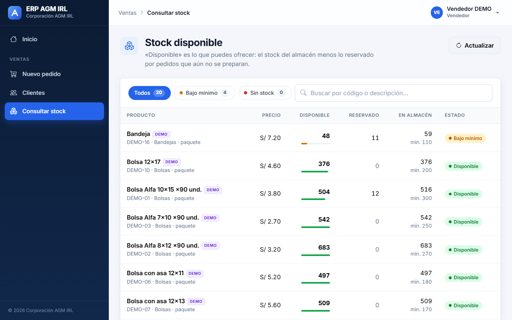

**HU03 — Filtro «Bajo mínimo» (agregado en el rediseño)**

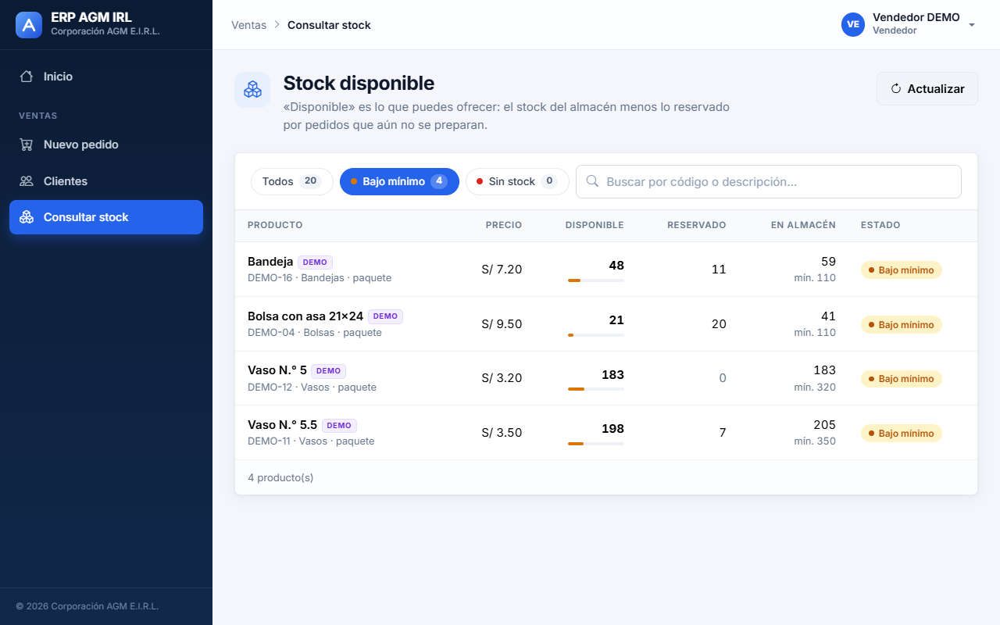

**HU04 — Registro de pedido: la cantidad supera el disponible y se avisa «Solo quedan 21»**

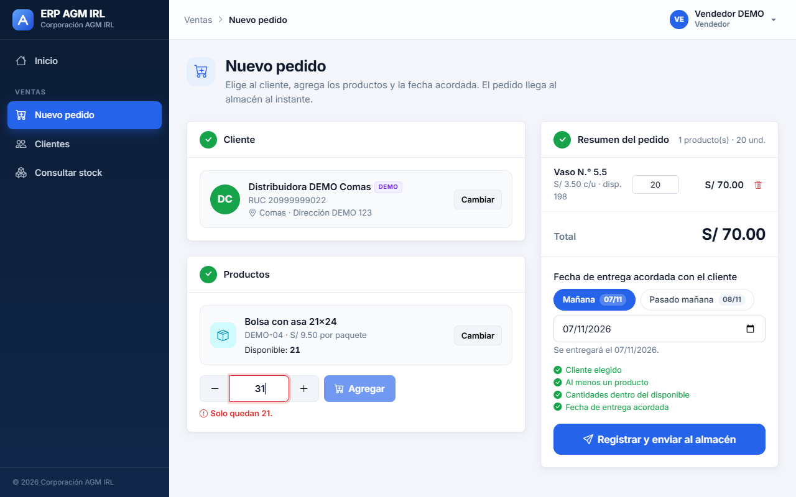

**HU04 — Pedido listo para registrar, con fecha de entrega acordada**

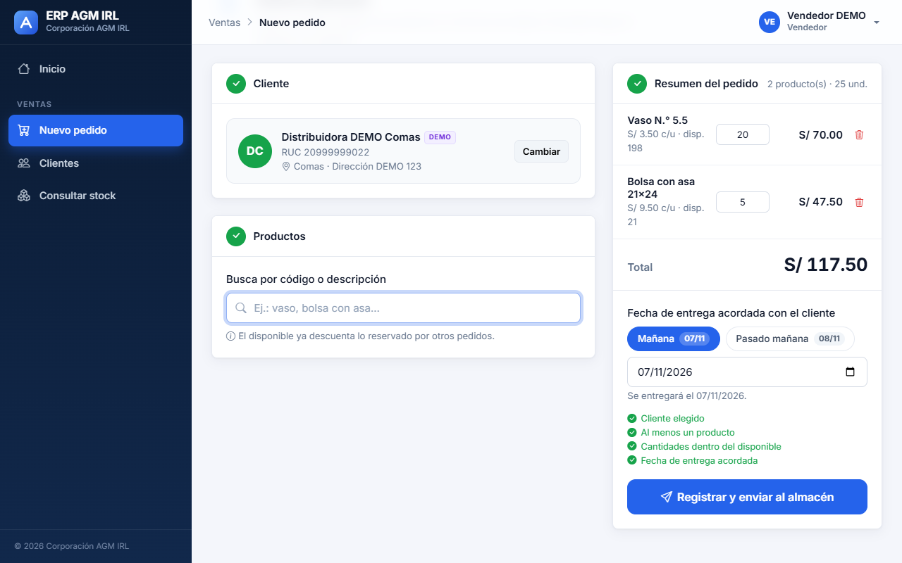

**HU04 — Pedido registrado: número, total y hora de registro puestos por el sistema**

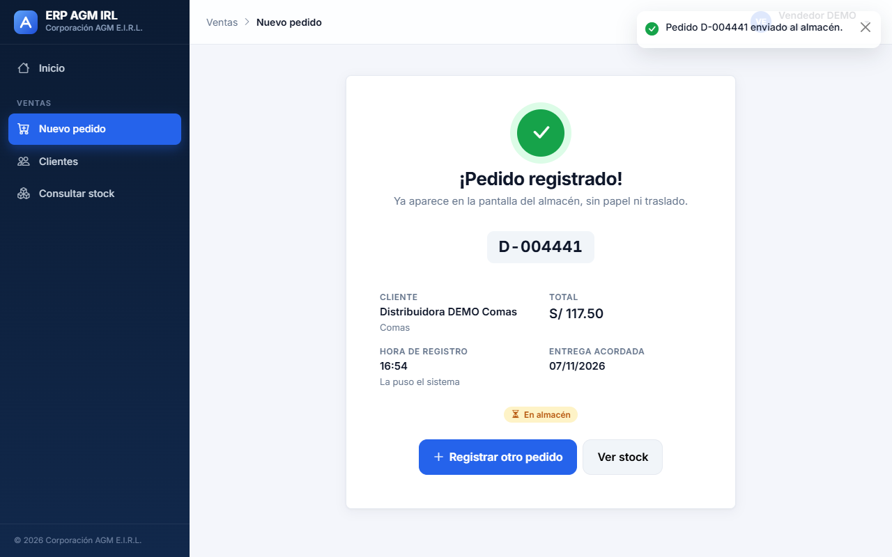

**HU03 y HU04 — Tras registrar 5 unidades, el disponible baja de 21 a 16 y lo reservado sube de 20 a 25; el stock en almacén (41) no cambia**

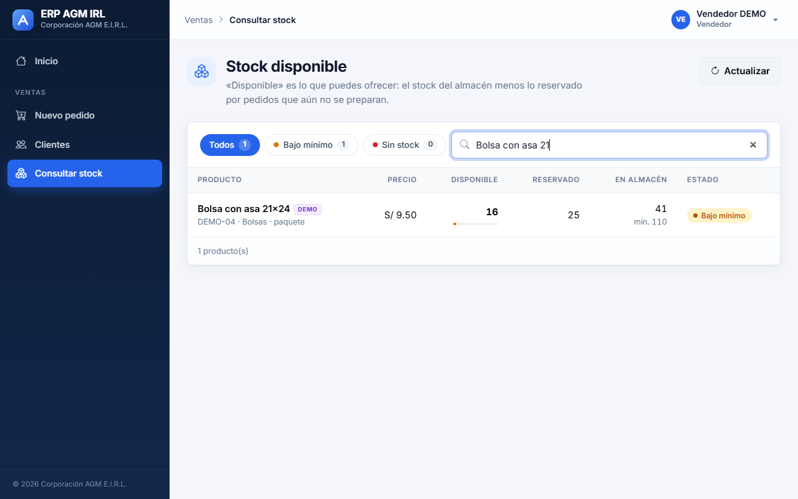

## Rediseño de la interfaz (observación de usabilidad)

**Origen.** La tesis (sección 7.1) establece que la usabilidad no tiene un sprint propio: se revisa en la Sprint Review
de cada sprint y sus observaciones vuelven al Product Backlog. En esta review el Product Owner observó que la interfaz
debía ser más moderna e intuitiva para que el personal la use sin dificultad. La observación se atendió antes de iniciar
el Sprint 2, sobre todas las pantallas construidas hasta ahora (Sprints 0 y 1). Commit `6cd93ff`, 06/11/2026.

**Qué cambió (solo la presentación y la facilidad de uso):**

- Tema visual propio sobre Bootstrap 5: paleta azul marino y azul, tipografía Inter, íconos de Bootstrap Icons,
  tarjetas y tablas más limpias y etiquetas de estado en píldoras de colores.
- Barra lateral oscura con un ícono por pantalla; las pantallas de sprints futuros se marcan «Pronto». La barra superior
  muestra dónde está el usuario (por ejemplo, «Ventas › Nuevo pedido») y su menú con «Cerrar sesión».
- Inicio de sesión en dos paneles, con la opción de mostrar la contraseña.
- Inicio por rol: saludo, resumen del día con cifras reales (pedidos en almacén, productos bajo mínimo o sin stock,
  clientes o usuarios) y accesos rápidos con una explicación de cada pantalla.
- Usuarios: el rol se elige con tarjetas que explican qué ve cada rol; filtros por rol y búsqueda.
- Clientes: avatar con iniciales, validación en vivo del RUC/DNI y sugerencia de los distritos de Lima y Callao, para que
  el distrito se escriba siempre igual (lo usará el reparto por distrito, HU10).
- Stock: filtros «Bajo mínimo» y «Sin stock» con su conteo, y una barra de nivel por producto.
- Nuevo pedido: pasos numerados que se marcan al completarse, selector de cantidad con − y +, resumen fijo a la derecha,
  atajos «Mañana» y «Pasado mañana», lista de comprobación antes de registrar, pantalla de confirmación con el número
  del pedido y barra inferior con el total en el celular.
- Avisos breves en la esquina al guardar y mensajes claros cuando una lista está vacía.

**Qué no cambió:** las historias de usuario, sus criterios de aceptación, el modelo de datos, la arquitectura y las
tecnologías de la tesis (React + Bootstrap 5; se agregaron Sass para personalizar Bootstrap, Bootstrap Icons y la fuente
Inter instalada localmente). En la API solo se agregaron dos parámetros opcionales de consulta: `?estado=` en el stock
(para los filtros) y `?por_pagina=` (para que el inicio pida solo los totales).

**Relación con los prototipos (Figs. 12 a 15).** Las pantallas conservan el contenido y el flujo de los prototipos
(buscar al cliente, agregar productos viendo el stock en ese momento, registrar con hora automática, menú por rol y
etiquetas de estado de colores), con una presentación más moderna. Los prototipos del Sprint 0 cumplieron su función de
explorar el diseño, y las pantallas finales se refinaron con la retroalimentación de la Sprint Review.

**Verificación del rediseño:**

| Verificación | Resultado |
|---|---|
| Pruebas automáticas del backend | **75 de 75 correctas** (2 nuevas en `inventario/tests/test_hu03_stock.py`: filtro por estado y `por_pagina`) |
| Compilación del frontend | `npm run build` sin errores |
| Pruebas en navegador (Chrome) | **49 de 49** comprobaciones: 26 del Sprint 0 (sesión, menú por rol, permisos, celular) y 23 del Sprint 1 (HU01 a HU04, reserva de stock, filtros y celular sin desplazamiento horizontal) |

## Observaciones

- Lo que registra un usuario DEMO (clientes, pedidos, usuarios) también queda marcado como DEMO, para que nunca se mezcle
  con datos reales y `borrar_demo` siempre pueda limpiarlo.
- El gerente no puede quitarse su propio rol ni desactivarse, para no quedarse sin acceso al sistema.
- La fecha acordada ya se guarda en la Entrega al registrar el pedido (forma parte de HU04 en el Product Backlog). La
  HU09 se revisará en el Sprint 3 junto con la pantalla del repartidor.
- La pantalla del almacén (HU05) es del Sprint 2; en este sprint se comprobó con la API que el pedido aparece en la lista
  del almacén.
