# Sprint Review — Sprint 2: Módulo de inventario

| Dato | Valor |
|---|---|
| Sprint | 2 — Módulo de inventario (Tabla II de la tesis, dimensión *Control del inventario*) |
| Fecha de la review | 06/11/2026 |
| Fecha planificada (Tabla II) | 16/11 al 20/11 |
| Commit del incremento | `10b4649` — «Sprint 2: módulo de inventario (HU05 a HU08)» (06/11/2026) |
| Pruebas automáticas del backend | **108 de 108 correctas** (33 nuevas en este sprint, 6 de ellas del ajuste del conteo, + 75 de los sprints 0 y 1) |
| Compilación del frontend | `npm run build` sin errores |
| Pruebas en navegador (Chrome) | **47 de 47** comprobaciones del Sprint 2 (flujos de HU05 a HU08 con el ajuste del conteo, permisos y celular) y **54 de 54** de regresión de los sprints 0 y 1 |
| Resultado | **Aprobado** por el Product Owner el 06/11/2026 |
| Cambio acordado en la review | «Ajustar el stock a lo contado», commit `5efd8ab` (06/11/2026); ver la sección «Decisión tomada en la review» |

## Objetivo del sprint

Que el almacén reciba los pedidos en pantalla apenas se registran, confirme su conformidad sin papel (el sistema
descuenta el stock y guarda la hora) y mantenga el stock al día con los ingresos de mercadería y el conteo físico,
que mide la exactitud del inventario.

## Historias de usuario terminadas

| ID | Historia de usuario (Tabla V) | Criterio de aceptación | Pruebas | Estado |
|---|---|---|---|---|
| HU05 | Como almacenero, quiero ver los pedidos pendientes en el orden en que llegan, para prepararlos sin esperar el papel. | La lista muestra cada pedido nuevo apenas se registra. | 4 (`inventario/tests/test_hu05_pedidos_por_preparar.py`) | ✅ Terminada |
| HU06 | Como almacenero, quiero confirmar el pedido preparado, para que se descuente el stock y quede la hora de conformidad. | Al confirmar, el stock baja en las cantidades del pedido y se guarda la hora. | 7 (`inventario/tests/test_hu06_confirmar_pedido.py`) | ✅ Terminada |
| HU07 | Como almacenero, quiero registrar el ingreso de mercadería, para mantener el stock al día. | El ingreso aumenta el stock y queda en el historial de movimientos. | 7 (`inventario/tests/test_hu07_ingresos.py`) | ✅ Terminada |
| HU08 | Como almacenero, quiero registrar el conteo físico, para comparar el stock real con el del sistema. | El sistema muestra la diferencia de cada producto y la exactitud del conteo. *Acordado en esta review:* el stock se puede ajustar a lo contado una sola vez por conteo. | 15 (`inventario/tests/test_hu08_conteo_fisico.py` y `test_hu08_ajuste_conteo.py`) | ✅ Terminada |

### Cómo se cumple cada criterio

- **HU05.** «Pedidos por preparar» muestra los pedidos en estado «En almacén» en el orden en que se registraron, con un
  número de turno, el cliente, el distrito, la hora de registro y cuánto llevan esperando. La lista se vuelve a pedir
  sola cada 10 segundos (y al volver a la pestaña): un pedido nuevo aparece al final de la cola, marcado «Nuevo», y la
  pantalla avisa «Llegó el pedido …». En Chrome, un pedido registrado por el vendedor en otra sesión apareció en 6
  segundos sin recargar la página.
- **HU06.** Al elegir un pedido se ven sus productos y cantidades con una casilla «Listo» por producto (como en el
  prototipo de la Fig. 13); «Confirmar pedido preparado» se activa cuando todos están marcados. Al confirmar se usa
  `Pedido.confirmar_conformidad()` (Fig. 11): baja `stock_actual` en las cantidades del pedido, crea un movimiento de
  **salida** por producto a nombre del almacenero, guarda la **hora de conformidad** (la pone el sistema; lo que envíe
  el usuario se ignora) y el pedido pasa a «Preparado». Abajo, «Conformes de hoy» muestra la hora de conformidad y el
  tiempo de atención (`tiempo_atencion()`), que es el indicador de la dimensión *Atención del pedido*. Un pedido no
  puede confirmarse dos veces.
- **HU07.** El almacenero busca el producto, escribe la cantidad (con − y +, o los atajos +10, +50 y +100) y ve cómo
  quedará el stock. Puede juntar varios productos y registrarlos a la vez; si una línea no es válida, no se registra
  ninguna. Cada línea crea un movimiento de **entrada** con usuario, fecha y hora del sistema. El «Historial de
  movimientos» muestra entradas, salidas y ajustes, del más reciente al más antiguo, con filtros por tipo y búsqueda.
  El vendedor ve el nuevo disponible en la consulta de stock (HU03).
- **HU08.** El almacenero agrega los productos a contar (uno por uno o una categoría completa) y anota lo que cuenta en
  el anaquel. Al registrar, el sistema guarda su propio stock (`stock_sistema`) y muestra, por producto, el stock del
  sistema, lo contado, la **diferencia** (contado − sistema) y si coincide; y la **exactitud** = productos que coinciden
  ÷ productos contados × 100, calculada con `ConteoFisico.calcular_exactitud()` (Fig. 11). La lista de conteos muestra
  la exactitud de cada uno. Es el dato de la *ficha de conteo físico* (indicador de exactitud del inventario).

### Pruebas que verifican los criterios

- `test_un_pedido_nuevo_aparece_en_la_lista_apenas_se_registra` (HU05): el pedido que registra el vendedor está en la
  lista del almacén en la siguiente consulta, con cliente, distrito, productos y fecha acordada.
- `test_al_confirmar_baja_el_stock_se_crean_las_salidas_y_se_guarda_la_hora` (HU06): con 100 y 40 unidades, un pedido de
  30 y 15 deja 70 y 25, crea dos salidas y guarda la hora de conformidad.
- `test_el_disponible_no_cambia_porque_la_reserva_pasa_a_ser_descuento` (HU06): al confirmar, lo reservado (Sprint 1)
  se convierte en descuento real; el disponible que ve el vendedor no cambia.
- `test_el_ingreso_aumenta_el_stock_y_queda_en_el_historial` (HU07).
- `test_muestra_la_diferencia_de_cada_producto_y_la_exactitud` (HU08): 4 productos, 2 coinciden → 50 %.

## Detalle de las pruebas automáticas (108)

| Archivo | Pruebas | Sprint |
|---|---|---|
| `inventario/tests/test_hu05_pedidos_por_preparar.py` | 4 | 2 |
| `inventario/tests/test_hu06_confirmar_pedido.py` | 7 | 2 |
| `inventario/tests/test_hu07_ingresos.py` | 7 | 2 |
| `inventario/tests/test_hu08_conteo_fisico.py` | 9 | 2 |
| `inventario/tests/test_hu08_ajuste_conteo.py` | 6 | 2 |
| Pruebas del Sprint 1 (HU01 a HU04 y filtros del rediseño) | 35 | 1 |
| Pruebas del Sprint 0 (modelos, autenticación y datos DEMO) | 40 | 0 |
| **Total** | **108** | |

## Evidencia (Chrome, 1280×800, datos DEMO)

**Inicio del almacenero: resumen con pedidos por preparar y conformes de hoy**

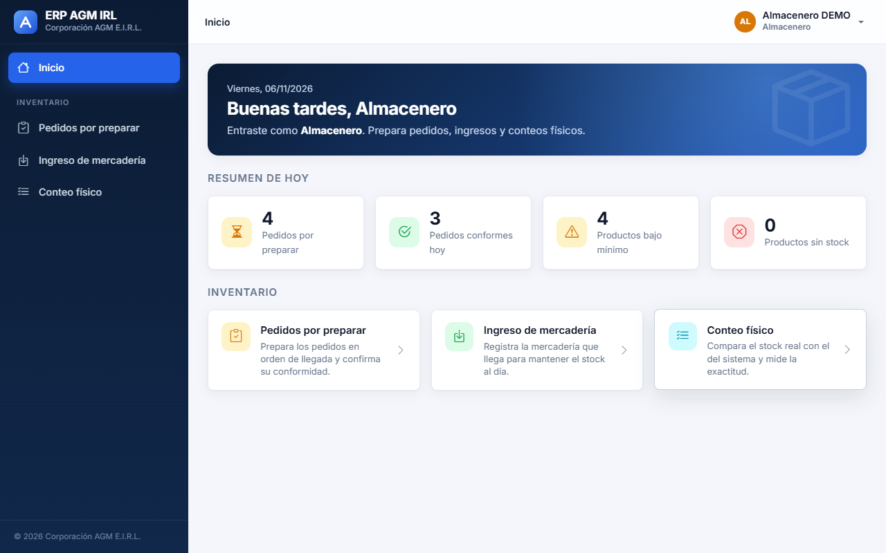

**HU05 — Pedidos por preparar, en orden de llegada (el más antiguo, elegido)**

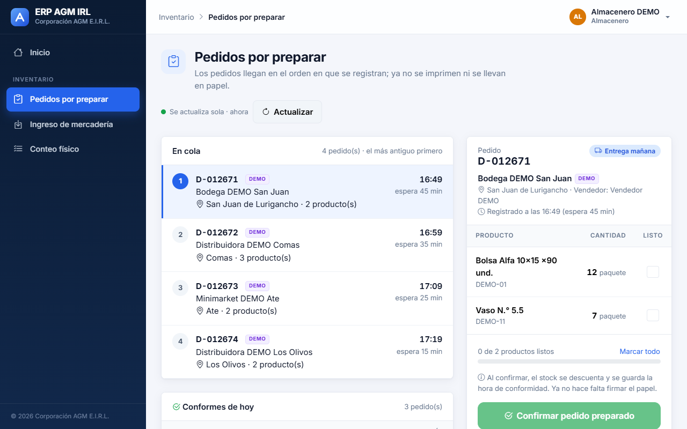

**HU05 — Un vendedor registra un pedido y aparece solo, al final de la cola, marcado «Nuevo»**

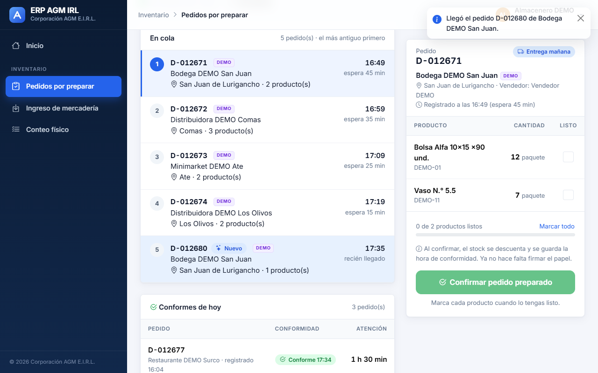

**HU06 — Productos marcados como listos: se puede confirmar el pedido preparado**

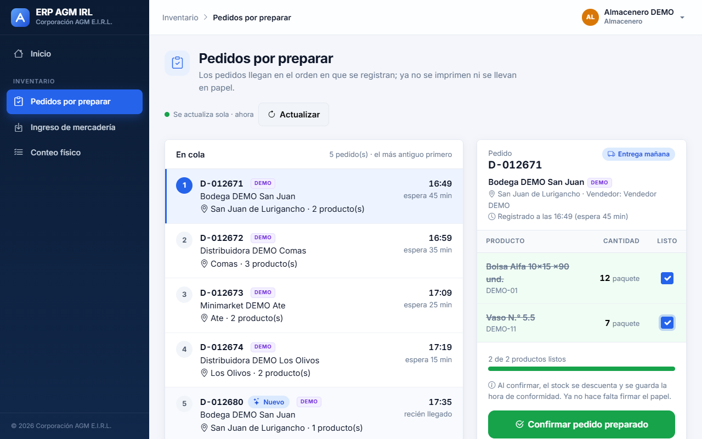

**HU06 — Pedido conforme: sale de la cola y pasa a «Conformes de hoy» con su hora y tiempo de atención**

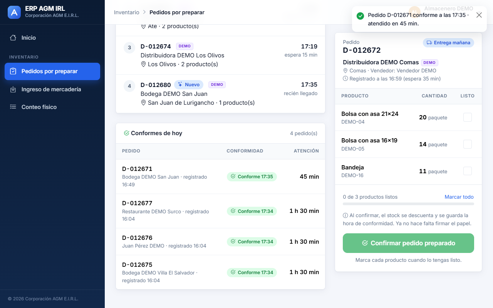

**HU06 — Los movimientos de salida que crea la conformidad, en el historial**

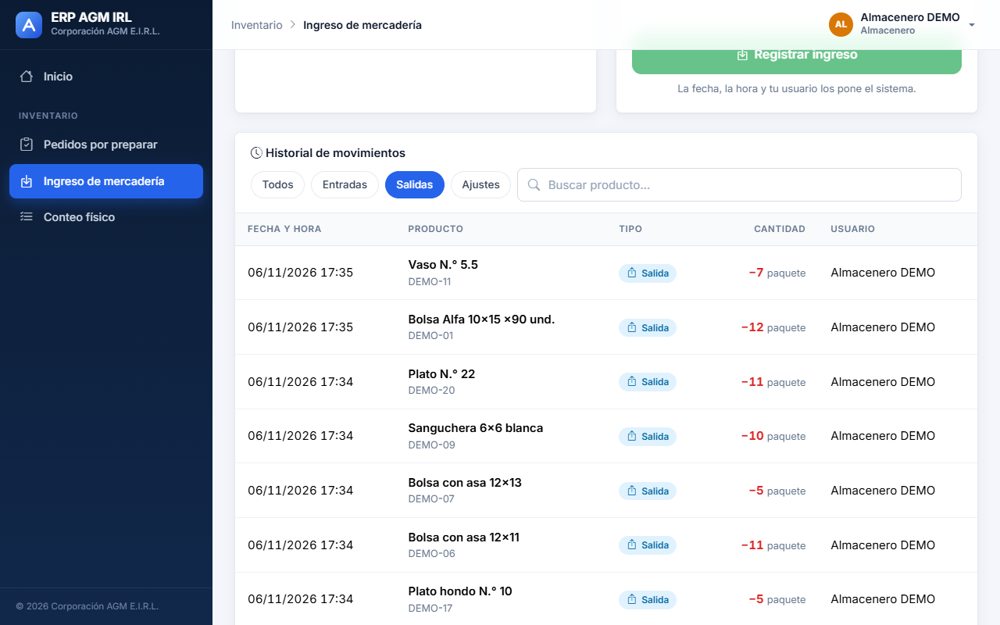

**HU07 — Ingreso de dos productos, con el stock que tendrá cada uno**

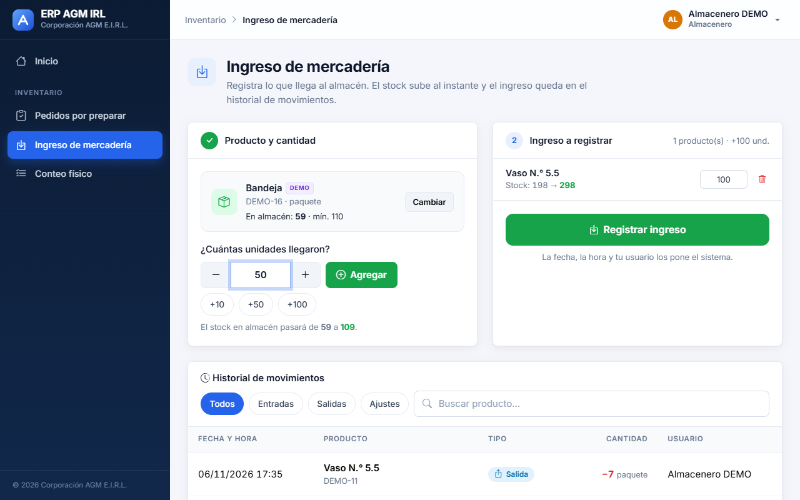

**HU07 — Ingreso registrado: el stock sube y las entradas encabezan el historial de movimientos**

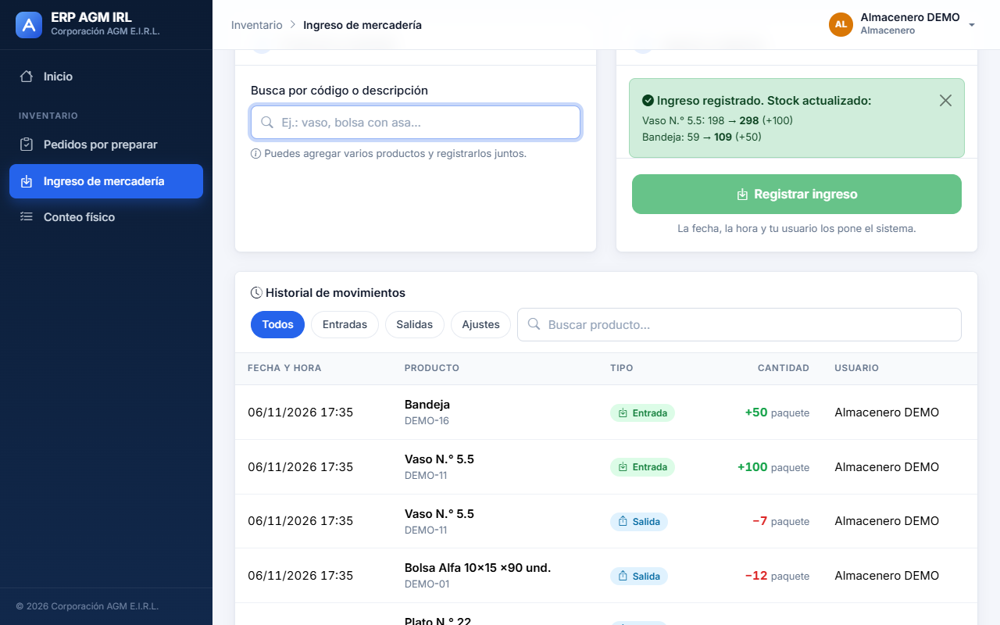

**HU08 — Conteos registrados con su exactitud (conteo DEMO: 18 de 20, 90 %)**

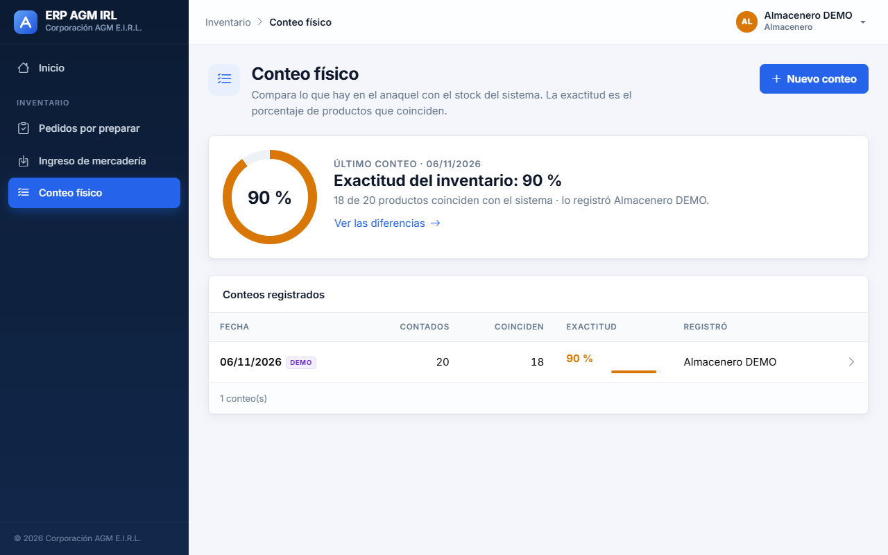

**HU08 — Nuevo conteo: se anota lo contado sin ver el stock del sistema**

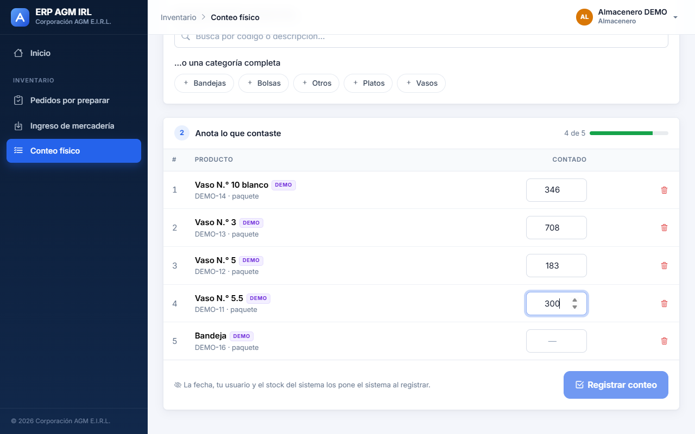

**HU08 — Resultado: diferencia por producto y exactitud (3 de 5, 60 %)**

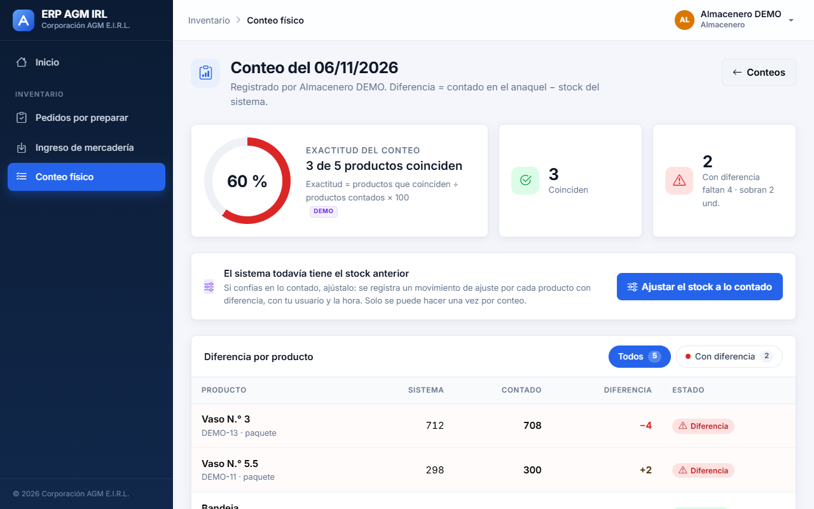

**HU08 — «Ajustar el stock a lo contado»: la confirmación muestra el ajuste de cada producto**

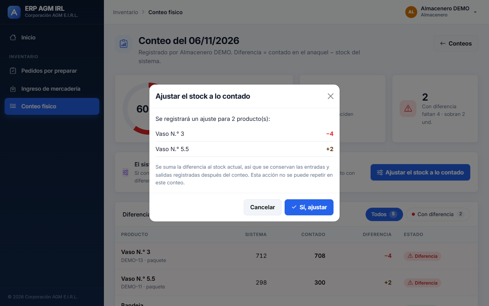

**HU08 — Stock ajustado: el conteo queda marcado y el botón ya no aparece (una sola vez por conteo)**

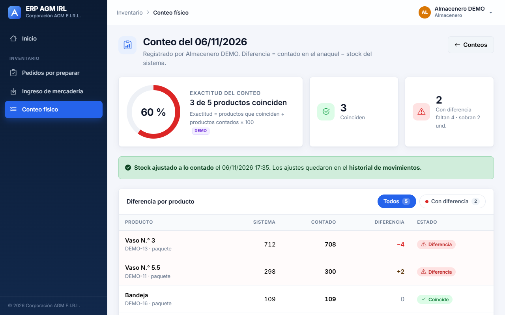

**HU08 — Los movimientos de ajuste (−4 y +2), con usuario y hora, en el historial**

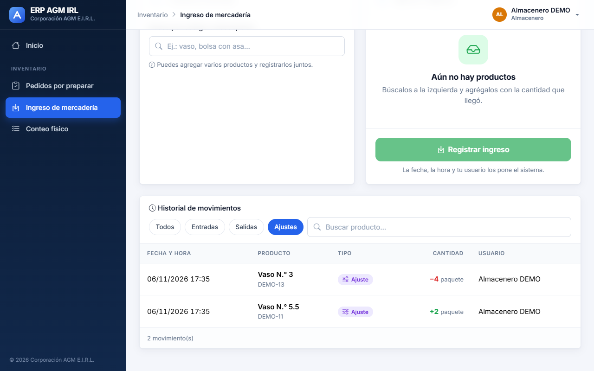

## Decisiones de implementación (no cambian el diseño)

- **Recarga periódica.** La lista del almacén se actualiza cada 10 segundos, como permite el prompt («puede ser con
  recarga periódica»). No se agregó otra tecnología (WebSocket).
- **Casillas «Listo».** Son una ayuda en pantalla para preparar el pedido, como en la Fig. 13; no se guardan (no cambia
  el modelo de datos). Lo que se guarda es la conformidad con su hora.
- **Conteo «a ciegas».** Mientras cuenta, el almacenero no ve el stock del sistema; el sistema lo guarda y lo compara al
  registrar. Así el conteo no se deja influir por el número del sistema y la exactitud que se mide es confiable.
- **Stock del sistema en el conteo.** Es `stock_actual` (el stock en almacén), no el disponible: lo reservado por pedidos
  sin preparar sigue físicamente en el anaquel y se cuenta.
- **Datos DEMO.** Los usuarios DEMO solo pueden confirmar pedidos DEMO y mover o contar productos DEMO, para que nunca
  toquen el stock real y `borrar_demo` pueda limpiarlo todo. Un conteo con productos DEMO queda marcado como DEMO.
- **Si no alcanza el stock en almacén al confirmar** (por ejemplo, salió mercadería sin registrar), el sistema no
  confirma nada y pide revisar el conteo físico.
- **API.** Endpoints nuevos en `/api/inventario/`: `pedidos/` (y `?conformes_hoy=1`), `pedidos/{id}/confirmar/`,
  `ingresos/`, `movimientos/`, `conteos/` y `categorias/`; el listado de productos acepta `?categoria=`. Todos validan
  el rol en el backend (almacenero y gerente).

## Decisión tomada en la review

| Tema | Decisión del Product Owner |
|---|---|
| Ajuste del stock después del conteo | Se agrega en el resultado del conteo el botón «Ajustar el stock a lo contado». Crea un movimiento de tipo «ajuste» (Fig. 10) por cada producto con diferencia, con usuario y hora del sistema, y se puede usar una sola vez por conteo. |

Cómo quedó (commit `5efd8ab`):

- La cantidad del ajuste es la diferencia del conteo (contado − sistema), con signo. Se **suma** al stock actual en vez
  de reemplazarlo por lo contado, para no borrar las entradas o salidas registradas después del conteo.
- Antes de ajustar se pide confirmación con la lista de productos y su diferencia. Después, el conteo queda marcado
  «Stock ajustado» con la fecha y la hora, y el botón desaparece; un segundo intento se rechaza (409).
- Si algún producto quedaría con stock negativo, no se ajusta ninguno. Si todo coincide, no hay nada que ajustar.
- La exactitud del conteo no cambia con el ajuste: mide cómo estaba el inventario cuando se contó.
- Para recordar que un conteo ya se ajustó se agregó el campo técnico `hora_ajuste` en ConteoFisico (migración
  `0003`), igual que `es_demo`: no cambia las relaciones ni los demás atributos del modelo de datos.

## Observaciones

- La entrega ya tiene su fecha acordada desde el registro del pedido (HU04); al confirmar, el pedido queda «Preparado»
  y listo para el reparto, que se construye en el Sprint 3 (HU09 a HU11).
- El gerente también puede usar las tres pantallas del almacén.
- Todas las pantallas se revisaron en un celular de 390 × 844 sin desplazamiento horizontal.
